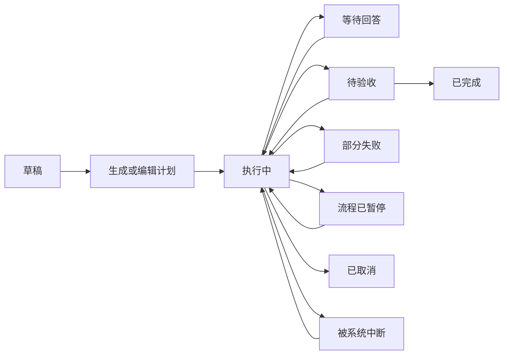

# Ai-XS 协作模式设计 v1

状态：设计稿，尚未接入 App。基于 0.8.7-alpha 的现有实现，2026-10-30。

预览：[交互原型](collaboration-preview.html)。原型使用示例数据，不调用 API、不启动 Agent、不修改项目。

## 1. 产品目标与默认值

用户提交一个目标，多个 Agent 拆解、分工、并行执行、互相审核，最后交付一份可追溯的成果。用户可以查看子任务、补充要求、回答问题、暂停或取消。

保留普通会话与跨 Agent 接手功能；协作任务从左侧菜单的“协作”进入。Ai-XS 继续使用原生 Android + Material，不引入网页作为 App 主界面。原型 HTML 仅用于评审交互。

| 项目 | 第一版决策 |
| --- | --- |
| 全局并行上限 | 默认 2，可选 1 / 2 / 3；作用于普通会话和协作子任务的总和 |
| 单 Agent 并行 | 每个 Agent 同时一个执行任务；同一种 Agent 的其他任务排队 |
| 重任务 | 同时最多 1 个；与普通任务一起计入全局并发 |
| 环境 | 共用现有 Ubuntu、Node、Python、Git 和 Agent 安装 |
| Agent 角色 | 用户指定，可互换，不按厂商固定能力或职责 |
| 账户 | 使用每个 Agent 已配置的官方 / 第三方 API |
| 主负责人 | 可选三个 Agent 中任意一个，拆解和汇总也占执行名额 |
| 首批模板 | 编程协作、资料整理与文档、空白流程 |
| 默认返工上限 | 每个阶段最多 2 次，可在启动前修改 |
| 恢复策略 | 保存已完成成果；中断的执行待用户选择恢复，不盲目重放工具 |
| 模式切换 | 当前会话可进入协作，也可回到独立模式；保留同一个可见会话 ID |

“两个并行”不是启动两套环境，也不要求三个 Agent 常驻。当前手机属于 16 GB 档，但空闲内存会变化，默认值仍需真机压力测试验证。

## 2. 页面和操作

### 左侧菜单

在现有“新建对话”下方增加“协作”入口，带运行数和待回答数。会话、项目入口保留，不增加底部导航栏。设置 → Agent 管理继续管理安装和启停；新增设置 → 协作与资源管理。

### 协作列表

顶部标题“协作”，右侧“新建”；下方显示紧凑资源摘要“运行 2/2 · 重任务 1/1”。列表卡片显示任务名称、项目、已完成数、运行者、等待原因和最近结果。支持进行中 / 待处理 / 已结束筛选。

卡片高度以内容决定；长标题最多两行。状态不只靠颜色，使用文字和图标。待处理包括等待回答、待验收、失败与中断；错误不自动打开日志。

### 新建协作

表单顺序：目标 → 项目 / 工作目录 → 交付要求 → 模板 → 参与 Agent → 负责人 → 并行数。项目字段使用紧凑目录行；模型、思考强度和权限由每个参与者的设置面板配置。

参与者展示安装状态、启停状态、配置的 API 来源与协议、模型；密钥只显示是否已配置。缺失安装或必要配置时，标明原因并提供相应入口。被手动停止的 Agent 不被协作静默启用。

“生成计划”产生可编辑的阶段卡片：负责人、依赖、任务范围、输出、是否重任务。计划通过后“开始协作”；用户也可以直接手动填写计划。计划生成失败保留表单并提供日志入口。

### 协作详情

顶部保留任务名、项目目录和紧凑进度；顺序显示：

1. 当前摘要：已完成 / 总数、实际运行 Agent、排队或暂停原因。
2. 待回答：复用现有提问与批准组件，标明 Agent / 子任务，不扩大为整页遮罩。
3. 子任务卡片：标题、Agent、状态、依赖、简短进度，点击展开详情。
4. 成果与验收：文件、修改摘要、测试结果、审核意见；未审核不得显示为“已交付”。
5. 底部紧凑输入区：项目目录在输入框上方；曲别针附件；模型在思考强度左侧；当前输入对象默认为负责人，可改为具体子任务。

“流程暂停”和“取消协作”置于顶部菜单；子任务详情提供停止、重试、改派。列表刷新仅更新发生变化的内容，阅读历史时不自动滚动。

### 子任务详情

显示目标、输入来源、Agent / 模型、实时活动、问题、结果、文件修改、用量。常规操作留在本页展示进度；失败显示可操作错误和“查看运行日志”，通过协作 / 子任务 / 尝试编号筛选 Debug。

### 当前会话与协作模式双向切换

普通会话顶部增加紧凑的“独立 / 协作”模式入口；通过点击打开模式面板，不做大胶囊占用对话空间。左侧“协作”是查看全部协作任务的入口，不是唯一启动方式。

**独立 → 协作**：使用当前会话、项目、选中的历史范围和最新需求作为输入，生成可编辑计划。模式切换本身不自动发送付费请求：用户点击“生成计划”才调用负责人，或者直接手动填写。确认开始后，主会话插入一条协作开始记录，原消息与 ID 保留，独立 CLI 的历史作为独立 binding 保留。

若当前独立任务正在执行，提供“完成后进入协作”与“中断当前任务后进入协作”，默认前者；不能在任务执行中改写其绑定或把半条输出当作最终交接结果。等待切换时显示可取消的提示。

**协作 → 独立**：选择继续使用的 Agent、模型和思考强度。默认携带已完成结果、审核状态、未完成问题和产物引用，明确区分已合入修改、未合入补丁与仅生成的草稿。保留全部子任务历史入口，已完成任务不消失，不重新计费回放。

如果仍有活动子任务，面板提供两种明确操作：

- “转入后台，回到独立”：原协作保留运行；独立模式也受全局 2 名额和每 Agent 1 名额约束，无名额时排队。同一项目中，独立任务默认只读；只有使用另一个独立工作区，或等待相关写入锁释放后，才允许修改。非 Git 共享目录写入不与协作写入重叠。
- “中断任务，回到独立”：先暂停协作派发，向本协作的全部活动任务发送中断；确认退出并回收租约后再开始独立任务。已有成果保留，协作标记为中断待处理。

没有活动任务时直接切换。切换前后的展示模式立刻变化不代表执行名额立刻释放；页面必须显示仍在运行 / 正在停止 / 排队的真实状态。取消模式面板不改变任何执行任务。

回到独立模式后，后台协作的结果显示为带时间、任务和产物版本的提示，不静默注入正在执行的独立 CLI。用户可“接收最新成果”，下一次任务重新生成交接包。编辑旧消息沿用现有分支机制，已有协作关联原始会话版本，不随编辑重写。

再次进入协作时，可“查看并继续已有协作”或“用当前目标新建协作”。已结束协作不会被普通模式切换重新执行；新执行需要明确点击开始 / 重试。

## 3. 协作语义

### 生命周期



暂停与取消必须分开：

- **流程暂停**：立刻停止派发新任务；已运行的任务继续到结束，页面明确显示“暂停派发 · 仍有 N 个任务运行”。暂停派发不会节省这部分任务的内存。
- **停止子任务 / 中断全部运行任务**：发送真实 interrupt，等待进程退出后释放名额。标记为中断，后续可新建一次尝试继续。
- **取消协作**：停止派发并中断本协作任务，保留已完成成果；普通会话任务不受影响。
- 不提供假装能冻结 CLI 后原地恢复的“暂停执行”按钮。恢复中断任务使用交接摘要和产物重新启动，明确告知不能保证恢复到原工具指令。

子任务状态：`blocked`（依赖未满足）、`queued`、`starting`、`running`、`waiting_input`、`succeeded`、`failed`、`interrupted`、`cancelled`、`skipped`。跳过必需任务会阻塞交付，不能伪装为成功。

完成必须包含可核对的产物 / 结果及阶段验收条件。文本自报成功不能替代文件存在、测试退出码、审核结论等检查。无法自动验证的办公文档进入人工验收。

与实现并行的只读检查只能提供基线风险和测试建议，不能提前审核尚未生成的修改。实现产物生成后，必须针对确切补丁 / 提交重新审核；最终审核通过和测试通过共同构成交付条件。审核与返工各次产物版本保留关联。

## 4. 全局调度

建立一个调度器统一接管普通对话和协作子任务。任何路径都不能绕过名额限制；普通消息可进入队列并在原会话显示排队原因。用户可提高优先级；同优先级按等待时间排序，避免一个协作独占全部名额。

派发条件同时满足：依赖完成、流程允许派发、目标 Agent 已启用且空闲、全局有名额、重任务名额可用、资源信息新鲜、文件与设备锁可用、API 退避结束。

```text
候选任务
  → 校验依赖和执行配置
  → 检查 Agent / 全局 / 重任务 / 文件 / 设备 / API 限制
  → 在同一事务内分配名额并写入 starting
  → 启动 CLI；记录进程身份和 attemptId
  → 接收事件与产物
  → 等待 CLI / 工具子进程退出确认
  → 原子写入结果并释放名额
  → 唤醒可执行的后续任务
```

UI 提交携带 `clientRequestId` 幂等键。点击重试、网络回调重复、服务重连不能产生重复执行。每次重试创建新的 `attemptId`；旧事件不得覆盖新尝试。

等待用户回答时，若 CLI / 工具仍存活，继续占用执行名额。先提示处理问题，不为追求“并发利用率”启动第三个进程。

普通会话内仍顺序执行；并行发生在独立会话或协作子任务之间。主协作会话是汇总视图，不把两个写入者同时绑定到现有 `SharedConversations.binding`。

## 5. 资源保护

以下是**初始实验阈值**，不是已测出的最低硬件要求；发布前根据真机压力测试调整。

Android 使用 `ActivityManager.MemoryInfo`、系统低内存回调和可用热状态采样；只传数值，不读取其他 App 的日志或隐私数据。运行时 Android 约每 5 秒向后端更新样本，后端以收到时间计新鲜度。温度不可读时不伪造温度。

| 状况 | 调度动作 |
| --- | --- |
| 可用内存低于 `max(1.5 GiB, 物理内存 10%)` 连续两次 | 暂停新派发，现有任务继续，显示原因 |
| 系统 `lowMemory`，或低于 `max(800 MiB, 系统 threshold)` | 立即停止新派发，主动提醒可中断任务 |
| 可用内存高于 `max(2 GiB, 物理内存 14%)` 连续 15 秒且非 lowMemory | 恢复资源允许的派发，用户主动暂停保持暂停 |
| Android 热状态达到 SEVERE | 暂停新重任务，普通任务上限暂降到 1，不中断已运行任务 |
| 资源样本超过 15 秒未更新 / 服务刚恢复 | 不扩大并发；最多一个轻任务，重任务等待新样本 |
| 存储不足以创建工作区或输出 | 提交前显示缺口，创建失败清理本次临时文件 |

不自动杀掉用户的运行任务。严重内存不足时系统仍可能终止进程，因此进度持久化和恢复是必需能力。换入换出 / 内存扩展不计入可用物理内存预算。

“重任务”初期由任务标记 + 已知工具识别共同决定：编译、依赖安装、浏览器自动化、大型测试。实际工具调用前应向调度器申请重任务锁；任意 shell 脚本无法仅靠字符串可靠分类，因此已知要运行此类命令的整个子任务先按重任务调度。

v1 不宣传硬内存隔离或绝对限制。PRoot / worktree 也不提供进程级安全沙箱，不能把软调度描述成操作系统强制隔离。

## 6. 文件、手机与 API 冲突

### 项目文件

- 同一项目只读任务可同时执行；写代码任务各用独立 Git worktree 和独立分支，基于固定提交。
- 有未提交修改时，保留原目录；让用户选择保存工作快照，或先运行只读任务。不能静默 stash、提交、丢弃用户改动。
- 非 Git 项目 v1 允许多个只读任务或多个独立输出目录任务；共享目录内修改最多一个写入者。
- worktree 共用 Git 对象，文件、依赖与生成物仍占空间。创建前检查容量，不在每个 worktree 重装一份 Ubuntu。
- 集成由唯一集成任务执行：审核补丁 → 检查目标基线 → 串行应用 → 测试 → 人工验收。目标基线变化或冲突时停留当前页，提供查看冲突、改派解决、保留产物入口。
- 清理仅针对确认已结束且产物已保留的工作区，绝不清理原项目目录。

### 手机和浏览器

无障碍点击、输入、滑动、切换 App 必须共用一个设备控制锁。浏览器 DOM/JavaScript/导航/截图初期共用浏览器锁，避免一个 Agent 导航后另一个读取错页面；需要手机截图时同时申请设备锁。日志读取和独立文件读取可以并行。

锁属于子任务尝试，不属于当前屏幕页面。取消 / 崩溃后校验执行者退出再回收；长时间未释放时显示阻塞原因，不能静默抢锁。

### API 与权限

复用现有 provider / 模型 / 思考 / 权限配置。任务启动时记录非敏感配置版本；密钥始终从私有配置读取，计划、事件与产物不复制密钥。

两个 Agent 使用同一个第三方网关时，按规范化服务地址与私有凭据引用分组限制并发。429 遵循 Retry-After，指数退避；限制重试次数和总时长。API 不支持并发时可配置每组最多一个请求任务。

权限在普通对话与协作中采用相同语义。复用批准 / 提问功能，增加协作、子任务和 attempt 标识。请求从终止任务到达时标为过期，不能批准到后来启动的任务。

## 7. 上下文与交付

每个子任务获得明确的交接包：用户目标、项目基线、范围、依赖任务摘要、关联产物路径、限制、验收标准。默认不转发其他 Agent 的全部内部会话或思考过程。

交接摘要有大小限制，超限时附文件引用和缺省提示，不把缺失信息当作已知。Agent 可主动读取所需产物。引用带版本 / 哈希，依赖返工后旧成果被标记过期，后续任务重新验证。

共享成果包括报告、代码差异、测试结果、截图、待解决问题。允许文本、Markdown、JSON、CSV、项目文件；PDF / Office 输出依赖相应工具，缺失时提示安装或选用支持格式，不预先承诺全部格式可编辑。

用量按 attempt → 子任务 → 协作聚合；包含计划、审核、返工和汇总。Agent 未报告用量时显示“部分数据缺失”，不用 0 冒充。只有配置可信模型价格时才估算费用。

## 8. 持久化和协议

新增私有 SQLite 数据库 `collaboration/state.db`，保存在现有运行时 `.state` 下，使用事务和 schema 迁移。普通会话原文件保持兼容。

主要表：`workflows`、`tasks`、`dependencies`、`attempts`、`events`、`artifacts`、`leases`、`resource_samples`。任务规格与运行状态分开；事件序号单调递增。数据库不写 API 密钥。

| 对象 | 核心字段 |
| --- | --- |
| 协作 | id, title, objective, project, ownerAgent, status, planVersion, createdAt |
| 会话模式 | conversationId, displayMode, independentBinding, activeWorkflowId, contextRevision, pendingTransition |
| 子任务 | id, workflowId, agent, model, goal, dependencies, workload, workspace, acceptance |
| 尝试 | id, taskId, number, state, nativeThreadId, nativeTurnId, configRevision, startedAt, endedAt |
| 租约 | ownerAttempt, kind, key, processIdentity, acquiredAt, heartbeatAt |
| 事件 | sequence, workflowId, taskId, attemptId, type, payload, timestamp |
| 产物 | id, attemptId, relativePath, kind, hash, sourceRevision, reviewStatus |

新增私有 RPC：

```text
native/collaboration/list, create, read, plan, updatePlan, start
native/collaboration/pause, resume, cancel, accept
native/collaboration/task/read, interrupt, retry, reassign
native/collaboration/artifacts/list
native/collaboration/settings/read, write
native/resources/report
native/chat/mode/read, set
native/collaboration/fromConversation, handoffToIndependent
```

事件采用 `collaboration/taskProgress`、`taskStateChanged`、`question`、`artifactAdded`、`workflowChanged` 和统一 `scheduler/changed`，携带相关编号。UI 用 sequence 补取断线期间遗漏事件。

后台重启时先核对旧进程身份（PID + 启动标识），终止 / 接管遗留进程后回收租约；无法确认时阻塞冲突资源并提示诊断，避免重复进程写文件。已完成产物保持；原 running/starting 任务进入 interrupted，提供逐项恢复选择。

## 9. 现有模块调整边界

| 现有模块 | 调整 |
| --- | --- |
| `RuntimeManager.guest()` | 将硬编码 `AI_XS_SINGLE_AGENT=1` 替换为能力配置；不能仅删除变量让 Codex 开机常驻 |
| `EngineManager` | 拆分“Agent 已启用”“任务调度”“进程回收”；受调度器管理时不再 `_activate()` 拒绝另一 Agent 或停止其进程 |
| `SharedConversations` | 主会话 ID 保持；独立 binding、展示模式和协作关联分开；协作子任务各自建立独立会话，不共用 binding；全局调度覆盖创建 / 恢复 / 提交路径 |
| `NativeHost` | 注册协作 RPC、持久化与全局调度；普通任务、MCP 创建任务也必须经过调度 |
| `RuntimeService` | 资源采样、活动任务通知、恢复与终止回执；不能因为页面退出停止任务 |
| `NativeHomeActivity` | 左侧协作入口；普通任务排队提示，不改变输入布局 |
| 新 `CollaborationActivity` | 原生列表、计划编辑、详情与成果验收 |
| `NativeApprovals` / 提问组件 | 为并行请求增加任务路由与待回答队列，验证不同 Agent 同时提问 |
| `AppLogs` / `app_logs` | 增加 workflowId/taskId/attemptId 关联；普通日志记录阶段，Debug 记录执行细节 |
| Agent 管理 | 停止 Agent 先阻止其排队任务派发，再中断其活动任务；全部停止同步暂停协作派发 |

更新 Agent 程序版本时，仍禁止其运行中版本被删除 / 替换。运行中的 Agent 不允许改 API 凭据或模型执行配置；排队任务使用配置版本检测，变更时提示重新确认计划。

## 10. 实施顺序与验收

### 阶段 A：全局调度与两个 Agent 真并行

先打通独立会话并发、全局 2 名额、每 Agent 1 名额、重任务 1 名额、停止与排队。通过受控测试开关验证，普通用户默认行为到验证通过才切换。

验收：两个不同 Agent 的真实执行区间有重叠；第三个排队；普通会话不能绕过限制；一个停止不影响另一个；单 Agent 两任务排队；CLI 启动失败 / 返回失败 / 超时全部释放名额。

### 阶段 B：原生协作工作台与可编辑计划

完成列表、新建、计划、依赖执行、负责人汇总、子任务提问路由和用量统计，并支持当前会话双向切换。先支持只读资料 / 独立输出办公任务。

验收：计划可编辑、依赖不提前运行、两个同时提问分别回答、错误留在当前页、返工有上限、已停止 Agent 不被自动启用；独立 → 协作 → 独立后会话 ID / 历史 / 用量保留，后台任务不静默覆盖当前上下文，无名额时排队，有冲突锁时不允许共享目录写入。

### 阶段 C：编程工作区与审核交付

增加 worktree、基线记录、修改审核、串行集成、重任务令牌及设备 / 浏览器锁。

验收：同时修改同名文件产生独立补丁；主项目无静默变动；冲突有明确状态；两个重任务不重叠；两个手机控制者不能交错点击；同网关限流可降级。

### 阶段 D：手机压力与恢复测试

测试 1 / 2 / 3 并发、长时间后台、锁屏、低内存、过热、服务被杀、API 429 / 断网、安装更新和手动停止。记录实际 PSS / 可用内存、任务耗时、恢复丢失范围、Token 数据完整性。达不到标准时保留 1 / 2 上限，3 并发标实验选项。

验收：进程被杀后不重复执行未知副作用；用户暂停不被资源恢复自动撤销；资源读数缺失不当作“内存充足”；读旧日志不跳动，所有失败可关联具体尝试。

## 11. 参考范围

2026-10-30 核对项目仓库 README。这里只借鉴交互和架构，尚未引入第三方项目代码或框架依赖。

- [Vibe Kanban](https://github.com/BloopAI/vibe-kanban)：任务看板、工作区、差异审核与反馈。
- [Claude Squad](https://github.com/smtg-ai/claude-squad)：多 Agent 会话、worktree 隔离。其许可为 AGPL-3.0；引入具体实现前单独核对许可兼容性。
- [LangGraph](https://github.com/langchain-ai/langgraph)：持久化状态、执行恢复与人工介入。
- [CrewAI](https://github.com/crewAIInc/crewAI)：角色分工、任务委派和显式流程。
- [Microsoft Agent Framework](https://github.com/microsoft/agent-framework)：交接、并行与检查点模式。

第一版采用现有 Python + SQLite 实现轻量调度，避免为手机引入整套桌面 / 云服务平台；后续根据功能和测试结果决定是否使用框架。
