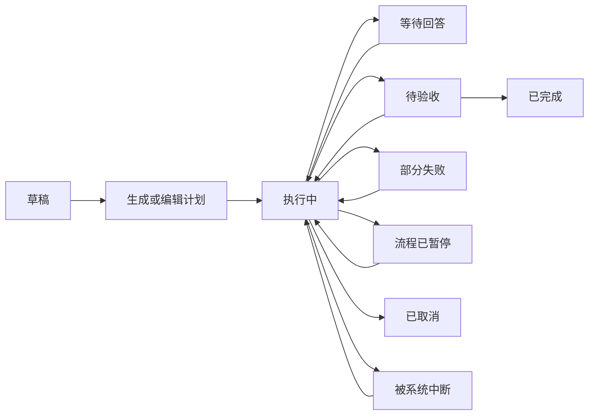

# Ai-XS 协作模式设计 v1.1

状态：完整实现规格。0.9.0-alpha 已接入协作首版；下文含尚未实现的高级功能，实际交付范围和限制以 [Android 协作说明](../android/COLLABORATION.md) 为准。初稿基于 0.8.7-alpha，2026-10-30。

预览：[交互原型](collaboration-preview.html)。原型使用示例数据，不调用 API、不启动 Agent、不修改项目。

可行性：[真实 CLI 隔离核验](COLLABORATION_FEASIBILITY.md)。三个 Agent 均通过本地模拟 API 的双实例 / 不同模型参数 / 独立终止实验；本轮生产调度器和真实 CLI 的验证范围见 [发布核验](../android/RELEASE_VERIFICATION.md)。

## 1. 产品目标与默认值

用户提交一个目标，多个 Agent 拆解、分工、并行执行、互相审核，最后交付一份可追溯的成果。用户可以查看子任务、补充要求、回答问题、暂停或取消。

保留普通会话与跨 Agent 接手功能；协作任务从左侧菜单的“协作”进入。Ai-XS 继续使用原生 Android + Material，不引入网页作为 App 主界面。原型 HTML 仅用于评审交互。

| 项目 | 第一版决策 |
| --- | --- |
| 全局并行上限 | 默认 2，可选 1 / 2 / 3；作用于普通会话和协作子任务的总和 |
| 单 Agent 并行 | 支持同一 Agent 建立多个独立参与者，分别选择模型；实例隔离验证前暂时顺序执行，验证后可在全局上限内并行 |
| 重任务 | 同时最多 1 个；与普通任务一起计入全局并发 |
| 环境 | 共用现有 Ubuntu、Node、Python、Git 和 Agent 安装 |
| Agent 角色 | 用户指定，可互换，不按厂商固定能力或职责 |
| 账户 | 使用每个 Agent 已配置的官方 / 第三方 API |
| 主负责人 | 从已添加的参与者中选择，拆解和汇总也占执行名额 |
| 首批模板 | 编程协作、资料整理与文档、空白流程 |
| 默认返工上限 | 每个阶段最多 2 次，可在启动前修改 |
| 恢复策略 | 保存已完成成果；中断的执行待用户选择恢复，不盲目重放工具 |
| 模式切换 | 当前会话可进入协作，也可回到独立模式；保留同一个可见会话 ID |
| 中途改派 | 支持换 Agent / 模型 / API 来源；默认后续生效，立即接手先中断再交接 |
| 权限 | 沿用当前已选模式，未选模式默认询问；改派不自动提高权限 |
| 自动换模型 | 关闭；模型不可用时明确失败，用户手动选择替代 |
| 记录清理 | 默认保留成果、历史和用量；工作区 / 诊断日志单独管理 |

“两个并行”不是启动两套环境，也不要求三个 Agent 常驻。当前手机属于 16 GB 档，但空闲内存会变化，默认值仍需真机压力测试验证。

## 2. 页面和操作

### 左侧菜单

在现有“新建对话”下方增加“协作”入口，带运行数和待回答数。会话、项目入口保留，不增加底部导航栏。设置 → Agent 管理继续管理安装和启停；新增设置 → 协作与资源管理。

### 协作列表

顶部标题“协作”，右侧“新建”；下方显示紧凑资源摘要“运行 2/2 · 重任务 1/1”。列表卡片显示任务名称、项目、已完成数、运行者、等待原因和最近结果。支持进行中 / 待处理 / 已结束筛选。

卡片高度以内容决定；长标题最多两行。状态不只靠颜色，使用文字和图标。待处理包括等待回答、待验收、失败与中断；错误不自动打开日志。

### 新建协作

表单顺序：目标 → 项目 / 工作目录 → 交付要求 → 模板 → 参与 Agent → 负责人 → 并行数。项目字段使用紧凑目录行；模型、思考强度和权限由每个参与者的设置面板配置。

### 参与者：Agent、模型与角色分开配置

参与者是一份独立执行配置：`participantId + Agent + 模型 + 思考强度 + 职责 + 权限`。界面使用“添加参与者”，允许多次选择同一个 Agent，也允许相同模型承担不同职责。负责人引用参与者 ID，而不是只引用 Agent 名称。

执行配置可保存为预设，包含 Agent、API 来源引用、模型、思考强度和权限。参与者选择预设后可以覆盖参数，并保留自己的职责与上下文。修改预设不修改已启动执行；启动时解析成不可变配置快照。第一版预设沿用该 Agent 已启用的工具 / Skills 范围并记录版本，不把尚未支持的参与者级工具覆盖做成可用开关。

例如全部使用 Codex：参与者一选当前 API 可用的模型 A 负责规划，参与者二选模型 B 负责实现，参与者三选模型 A 负责审核。也可混用 Claude Code、DeepSeek 与 Codex。模型列表取自该 Agent 的实际配置 / 发现结果，支持用户填写模型 ID；填写成功不代表协议、工具和思考参数一定兼容，运行前需做能力校验。不展示未经确认的固定模型名称或宣称任意模型跨 Agent 通用。

同 Agent 多模型可以顺序执行，也可以在隔离验证通过后并行。不同模型名不会增加可用名额：默认全局仍最多两个运行任务，同一 API 网关的并发限制仍有效。工作区、设备控制、权限请求、提问、用量与日志均按参与者 / 尝试隔离。

并行不能通过轮流修改全局模型或 provider 配置实现。每次尝试固定模型、思考参数、provider 配置版本和私有凭据引用。需要单独 provider 配置文件的 CLI 使用独立实例目录；共享安装程序和运行环境，不为每个参与者复制一套系统。Skills / 插件启用范围先沿用 Agent 配置并记录版本，后续再支持参与者级覆盖。

当前 Codex Android 适配器的 `AppServer` 是单一进程对象，Claude / DeepSeek 也有共享缓存和配置路径。需增加 `workerId` 路由和实例池，或验证隔离会话的协议复用后，才能开放同 Agent 真并行。未完成适配时，界面明确显示“该 Agent 当前仅支持顺序执行”；计划仍允许多个参与者复用这个 Agent。

参与者展示安装状态、启停状态、配置的 API 来源与协议、模型；密钥只显示是否已配置。缺失安装或必要配置时，标明原因并提供相应入口。被手动停止的 Agent 不被协作静默启用。

“生成计划”产生可编辑的阶段卡片：负责人、依赖、任务范围、输出、是否重任务。计划通过后“开始协作”；用户也可以直接手动填写计划。计划生成失败保留表单并提供日志入口。

每张阶段卡片从参与者列表选择执行者，显示“职责 · Agent · 模型”。改变 Agent、模型、职责或删除参与者时，负责人选项同步更新；已分配任务禁止静默改派。自动分工仅能从用户启用且能力校验通过的参与者中选择，计划展示选择理由和依赖，用户可覆盖。暂不承诺根据模型名称自动判断能力或最低价格；缺少价格信息时不做成本最优推荐。

### 协作详情

顶部保留任务名、项目目录和紧凑进度；顺序显示：

1. 当前摘要：已完成 / 总数、实际运行 Agent、排队或暂停原因。
2. 待回答：复用现有提问与批准组件，标明 Agent / 子任务，不扩大为整页遮罩。
3. 子任务卡片：标题、Agent、状态、依赖、简短进度，点击展开详情。
4. 成果与验收：文件、修改摘要、测试结果、审核意见；未审核不得显示为“已交付”。
5. 底部紧凑输入区：项目目录在输入框上方；曲别针附件；模型在思考强度左侧；当前输入对象默认为负责人，可改为具体子任务。

“流程暂停”和“取消协作”置于顶部菜单；子任务详情提供停止、重试、改派。列表刷新仅更新发生变化的内容，阅读历史时不自动滚动。

### 子任务详情

显示目标、输入来源、Agent / 模型、实时活动、问题、结果、文件修改、用量。常规操作留在本页展示进度；失败显示可操作错误和“查看运行日志”，通过协作 / 子任务 / 尝试编号筛选 Debug。

### 当前会话与协作模式双向切换

普通会话顶部增加紧凑的“独立 / 协作”模式入口；通过点击打开模式面板，不做大胶囊占用对话空间。左侧“协作”是查看全部协作任务的入口，不是唯一启动方式。

**独立 → 协作**：使用当前会话、项目、选中的历史范围和最新需求作为输入，生成可编辑计划。模式切换本身不自动发送付费请求：用户点击“生成计划”才调用负责人，或者直接手动填写。确认开始后，主会话插入一条协作开始记录，原消息与 ID 保留，独立 CLI 的历史作为独立 binding 保留。

若当前独立任务正在执行，提供“完成后进入协作”与“中断当前任务后进入协作”，默认前者；不能在任务执行中改写其绑定或把半条输出当作最终交接结果。等待切换时显示可取消的提示。

**协作 → 独立**：选择继续使用的 Agent、模型和思考强度。默认携带已完成结果、审核状态、未完成问题和产物引用，明确区分已合入修改、未合入补丁与仅生成的草稿。保留全部子任务历史入口，已完成任务不消失，不重新计费回放。

如果仍有活动子任务，面板提供两种明确操作：

- “转入后台，回到独立”：原协作保留运行；独立模式也受全局 2 名额、Agent 执行实例能力和 API 上限约束，无名额时排队。同一项目中，独立任务默认只读；只有使用另一个独立工作区，或等待相关写入锁释放后，才允许修改。非 Git 共享目录写入不与协作写入重叠。
- “中断任务，回到独立”：先暂停协作派发，向本协作的全部活动任务发送中断；确认退出并回收租约后再开始独立任务。已有成果保留，协作标记为中断待处理。

没有活动任务时直接切换。切换前后的展示模式立刻变化不代表执行名额立刻释放；页面必须显示仍在运行 / 正在停止 / 排队的真实状态。取消模式面板不改变任何执行任务。

回到独立模式后，后台协作的结果显示为带时间、任务和产物版本的提示，不静默注入正在执行的独立 CLI。用户可“接收最新成果”，下一次任务重新生成交接包。编辑旧消息沿用现有分支机制，已有协作关联原始会话版本，不随编辑重写。

再次进入协作时，可“查看并继续已有协作”或“用当前目标新建协作”。已结束协作不会被普通模式切换重新执行；新执行需要明确点击开始 / 重试。

### 任务中途更换 Agent、模型或 API 来源

子任务菜单提供“更换执行者 / 模型”；普通会话沿用 Agent / 模型选择入口，并在运行时打开相同的切换面板。面板显示原配置、目标参与者或新配置、权限变化、交接范围、预计排队原因；模型列表由目标 Agent 与 API 来源共同决定。

| 任务状态 | 操作规则 |
| --- | --- |
| 尚未开始 / 排队 | 仅修改选择的任务分配，递增计划版本后重新校验；保留排队时长，不自动开始 |
| 正在运行 / 等待回答 | 默认“后续任务使用新配置，当前任务继续”；可选“中断当前任务并交接”，先中断、核实执行者退出并保存成果，再新建尝试接手 |
| 已中断 / 失败 | 选择新配置后“接手并继续”，使用新 attemptId；需要重做时明确选择从任务起点重做 |
| 已完成 | 保留原执行者与验收证据；可修改后续任务。要重做已完成任务需明确点击“改派重做”，并重新核对受影响的下游成果 |

范围默认“仅此任务”；可选“此参与者尚未开始的任务”，面板列出确切任务。一个正在运行的任务已经完成后，不因之前选择的“后续生效”而重跑；没有后续任务时只保存新的会话默认配置，并明确提示。更换负责人默认只影响后续规划 / 汇总步骤，已运行的步骤继续或由用户选择中断。

执行尝试启动后，Agent、模型、provider、思考参数、权限与工具版本固定。切换保留 taskId、conversationId 和既有尝试记录，增加 assignmentRevision、目标配置快照和切换记录；当前参与者仍被其他任务使用时，优先新建参与者，避免批量改动其身份。已发生的用量始终归原尝试，不转到新 Agent 名下，也不因切换归零。

“中断并交接”的实际流程：记录切换意图并阻止旧任务再派发 → 请求中断 → 等待 CLI 和相关工具退出 → 保存已知文件状态、未合入差异、工具执行结果与未知状态 → 生成交接包 → 作废旧审批 → 重新校验目标配置 → 排队新尝试。任务在此期间显示 stopping / preparing_handoff / queued，页面切换不代表旧执行者已退出。

中断超时不会直接启动第二个写入者。超过 10 秒显示停止进度，30 秒仍无法确认时提供“继续等待”和“结束此执行实例”入口；结束后仍需核实受管子进程 / 文件锁。无法确认副作用或进程是否退出时标记 needs_reconciliation，保留冲突锁；允许用户检查后确认状态，或换独立工作区处理只读工作，不盲目回放命令。这里的超时是初始 UI 值，真机测量后可调整。

交接默认包含当前需求、完成清单、未完成问题、工作区 / 基线、产物版本、已执行工具和未确认操作。只传必要的用户与助手可见内容，不传密钥和私有思考。若需模型生成摘要，显示为一次受调度的执行并计入用量；原始记录和确定性清单始终可用，不能把摘要生成失败当作原成果丢失。摘要长度按目标模型容量裁剪，保留产物引用与缺失提示。

目标 Agent 未安装 / 已停止、模型或协议不兼容、思考强度 / 必需工具不支持时，在切换面板显示原因并提供入口。无相同思考参数时列出目标支持项让用户明确选择；不默默降级，不将原模型缓存或内部执行状态冒充可跨 Agent 迁移。

切换可取消；取消尚未实施的意图保留原任务。旧任务已中断后取消，不自动恢复旧任务，只保留中断状态并提供继续入口。切换与旧任务自然完成竞争时，以数据库中的 attemptRevision 和终态为准，避免双重派发。

## 3. 协作语义

### 生命周期



暂停与取消必须分开：

- **流程暂停**：立刻停止派发新任务；已运行的任务继续到结束，页面明确显示“暂停派发 · 仍有 N 个任务运行”。暂停派发不会节省这部分任务的内存。
- **停止子任务 / 中断全部运行任务**：发送真实 interrupt，等待进程退出后释放名额。标记为中断，后续可新建一次尝试继续。
- **取消协作**：停止派发并中断本协作任务，保留已完成成果；普通会话任务不受影响。
- 不提供假装能冻结 CLI 后原地恢复的“暂停执行”按钮。恢复中断任务使用交接摘要和产物重新启动，明确告知不能保证恢复到原工具指令。

子任务状态：`blocked`（依赖未满足）、`queued`、`starting`、`running`、`waiting_input`、`stopping`、`preparing_handoff`、`needs_reconciliation`、`succeeded`、`failed`、`interrupted`、`cancelled`、`skipped`。跳过必需任务会阻塞交付，不能伪装为成功。

完成必须包含可核对的产物 / 结果及阶段验收条件。文本自报成功不能替代文件存在、测试退出码、审核结论等检查。无法自动验证的办公文档进入人工验收。

与实现并行的只读检查只能提供基线风险和测试建议，不能提前审核尚未生成的修改。实现产物生成后，必须针对确切补丁 / 提交重新审核；最终审核通过和测试通过共同构成交付条件。审核与返工各次产物版本保留关联。

## 4. 全局调度

建立一个调度器统一接管普通对话和协作子任务。所有由 App 管理的入口都经过名额限制；普通消息可进入队列并在原会话显示排队原因。用户可提高优先级；同优先级按等待时间排序，避免一个协作独占全部名额。

派发条件同时满足：依赖完成、流程允许派发、目标 Agent 已启用且有隔离执行实例可用、参与者空闲、全局有名额、重任务名额可用、资源信息新鲜、文件与设备锁可用、API 退避结束。

```text
候选任务
  → 校验依赖和执行配置
  → 检查 Agent / 全局 / 重任务 / 文件 / 设备 / API 限制
  → 在同一事务内分配名额并写入 starting
  → 启动 CLI；记录进程身份和 attemptId
  → 接收事件与产物
  → 等待 CLI / 工具子进程退出确认
  → 原子写入结果并释放名额
  → 唤醒可执行的后续任务
```

调度器不在等待数据库锁时执行 CLI / 网络 I/O；资源预留使用事务记录，启动失败通过幂等回滚释放。多资源按固定顺序申请（项目 → 设备 → 浏览器 → 重任务），能在派发前确定的资源一次性预留。运行中发现需要新锁时使用 try-acquire 与可取消等待，不无限嵌套持锁；两个存活 worker 都在等资源时不再派第三个。适配器无法安全让出资源的任务，先中断交接或把阶段拆开，不能靠超卖名额解决死锁。工具操作与租约绑定由工具适配层验证，不能仅在提示词中要求 Agent 自觉排队。

UI 提交携带 `clientRequestId` 幂等键。点击重试、网络回调重复、服务重连不能产生重复执行。每次重试创建新的 `attemptId`；旧事件不得覆盖新尝试。

这里的名额统计受管执行实例，不等于全部操作系统进程或精确 HTTP 请求数。CLI 自带的子 Agent、内部并发工具和用户 shell 启动的进程可能增加消耗；第一版不自动开启原生嵌套委派，不宣称能强制限制任意脚本的全部子进程。支持的任务委派工具必须返回调度器排队；适配器无法纳管的嵌套执行能力需明确标注。

等待用户回答时，若 CLI / 工具仍存活，继续占用执行名额。先提示处理问题，不为追求“并发利用率”启动第三个进程。

普通会话内仍顺序执行；并行发生在独立会话或协作子任务之间。主协作会话是汇总视图，不把两个写入者同时绑定到现有 `SharedConversations.binding`。

## 5. 资源保护

以下是**初始实验阈值**，不是已测出的最低硬件要求；发布前根据真机压力测试调整。

Android 使用 `ActivityManager.MemoryInfo`、系统低内存回调和可用热状态采样；只传数值，不读取其他 App 的日志或隐私数据。运行时 Android 约每 5 秒向后端更新样本，后端以收到时间计新鲜度。温度不可读时不伪造温度。

| 状况 | 调度动作 |
| --- | --- |
| 可用内存低于 `max(1.5 GiB, 物理内存 10%)` 连续两次 | 暂停新派发，现有任务继续，显示原因 |
| 系统 `lowMemory`，或低于 `max(800 MiB, 系统 threshold)` | 立即停止新派发，主动提醒可中断任务 |
| 可用内存高于 `max(2 GiB, 物理内存 14%)` 连续 15 秒且非 lowMemory | 恢复资源允许的派发，用户主动暂停保持暂停 |
| Android 热状态达到 SEVERE | 暂停新重任务，普通任务上限暂降到 1，不中断已运行任务 |
| 资源样本超过 15 秒未更新 / 服务刚恢复 | 不扩大并发；最多一个轻任务，重任务等待新样本 |
| 存储不足以创建工作区或输出 | 提交前显示缺口，创建失败清理本次临时文件 |

不自动杀掉用户的运行任务。严重内存不足时系统仍可能终止进程，因此进度持久化和恢复是必需能力。换入换出 / 内存扩展不计入可用物理内存预算。

worker 生命周期第一版固定为进程 / 配置目录隔离，执行完成后等待子进程退出再释放；默认不保留空闲 CLI 常驻。同来源的 DeepSeek 冷启动成本作为后续优化项，只有验证缓存、权限和工具范围隔离后才增加带明确 TTL 的实例复用；不能为复用改变上述首版资源语义。

“重任务”初期由任务标记 + 已知工具识别共同决定：编译、依赖安装、浏览器自动化、大型测试。实际工具调用前应向调度器申请重任务锁；任意 shell 脚本无法仅靠字符串可靠分类，因此已知要运行此类命令的整个子任务先按重任务调度。

v1 不宣传硬内存隔离或绝对限制。PRoot / worktree 也不提供进程级安全沙箱，不能把软调度描述成操作系统强制隔离。

## 6. 文件、手机与 API 冲突

### 项目文件

- 同一项目只读任务可同时执行；写代码任务各用独立 Git worktree 和独立分支，基于固定提交。
- 有未提交修改时，保留原目录；让用户选择保存工作快照，或先运行只读任务。不能静默 stash、提交、丢弃用户改动。
- 非 Git 项目 v1 允许多个只读任务或多个独立输出目录任务；共享目录内修改最多一个写入者。
- worktree 共用 Git 对象，文件、依赖与生成物仍占空间。创建前检查容量，不在每个 worktree 重装一份 Ubuntu。
- 集成由唯一集成任务执行：审核补丁 → 检查目标基线 → 串行应用 → 测试 → 人工验收。目标基线变化或冲突时停留当前页，提供查看冲突、改派解决、保留产物入口。
- 清理仅针对确认已结束且产物已保留的工作区，绝不清理原项目目录。

### 手机和浏览器

无障碍点击、输入、滑动、切换 App 必须共用一个设备控制锁。浏览器 DOM/JavaScript/导航/截图初期共用浏览器锁，避免一个 Agent 导航后另一个读取错页面；需要手机截图时同时申请设备锁。日志读取和独立文件读取可以并行。

锁属于子任务尝试，不属于当前屏幕页面。取消 / 崩溃后校验执行者退出再回收；长时间未释放时显示阻塞原因，不能静默抢锁。

### API 与权限

API 来源扩展为每 Agent 可保存多个具名配置，类型只包含“官方 API / 第三方 API”，不继承手机或 Termux 账号。现有 App 内配置迁移为各 Agent 的默认来源，保留当前第三方来源和模型选择；不重置为官方、不要求重填已有密钥。参与者可各选不同来源，同 Agent 的两个参与者也可使用不同来源。

设置 → API 配置管理来源；设置 → 协作与资源管理管理执行预设和资源。协作表单提供紧凑来源选择和“管理配置”入口，管理完成返回原表单并保留草稿。保存新默认配置只影响后续执行；修改正在使用的密钥需待相关执行结束，或创建新来源。使用中的旧版本引用不能删除；用户强制撤销来源时先阻止派发并选择是否中断相关任务。

来源记录包含 providerRef、revision、类型、地址、协议、模型列表及私有凭据引用；执行配置不保存密钥正文。复用现有模型 / 思考 / 权限语义，任务启动时记录非敏感配置快照。模型发现结果按 Agent + 来源版本缓存，切换来源不能沿用另一来源的可用模型列表。安装程序、CLI 版本、工具范围同样进入能力缓存键。

保存配置先做本地校验；“验证连接”是明确操作，不因打开页面或切换模式自动发付费探测。能力未知时标“待验证”，不能标成已兼容；第一次真实任务按请求执行并报告不兼容原因。任务需要工具调用、图片等能力时，校验所需项；未验证项保持未知，必需能力不支持则阻止派发。

两个 Agent 使用同一个第三方网关时，按规范化服务地址与私有凭据引用分组限制并发。默认组上限跟随全局上限；同一地址的不同来源可手工绑定同一限制组，以覆盖服务器按账户统一限流的情况。429 遵循 Retry-After，指数退避；限制重试次数和总时长。API 不支持并发时可配置每组最多一个活跃执行实例。该限制不等于网关内部的精准 QPS；CLI 内部并发请求仍依赖其限流反馈。

权限在普通对话与协作中采用相同语义。新建参与者继承所选配置的明确权限；没有已选权限时默认询问。计划审核不是所有工具操作的总批准，负责人也不能替用户批准其他参与者的请求。复用批准 / 提问功能，增加协作、子任务和 attempt 标识。请求从终止任务到达时标为过期，不能批准到后来启动的任务。

## 7. 上下文与交付

每个子任务获得明确的交接包：用户目标、项目基线、范围、依赖任务摘要、关联产物路径、限制、验收标准。默认不转发其他 Agent 的全部内部会话或思考过程。

交接摘要有大小限制，超限时附文件引用和缺省提示，不把缺失信息当作已知。Agent 可主动读取所需产物。引用带版本 / 哈希，依赖返工后旧成果被标记过期，后续任务重新验证。

共享成果包括报告、代码差异、测试结果、截图、待解决问题。允许文本、Markdown、JSON、CSV、项目文件；PDF / Office 输出依赖相应工具，缺失时提示安装或选用支持格式，不预先承诺全部格式可编辑。

用量按 attempt → 子任务 → 协作聚合；包含计划、摘要、审核、返工和汇总，并保留 Agent / 模型 / 来源维度。中途改派和普通 / 协作模式切换不清零。Token 累计、当前上下文占用和费用分开展示；DeepSeek 当前 ACP 的 usage_update 是上下文占用，不直接加入累计计费 Token。Agent 未报告完整用量时显示“部分数据缺失”，不用 0 冒充。只有配置可信模型价格时才估算费用。

用量事件按 workerId、原生会话、attemptId 和事件序号去重。CLI 上报累计值时保存上次快照，只累加有效增量；恢复 / 新尝试的计数重置必须明确关联新执行，不把历史快照再计费。每个合计字段保留 reported / estimated / unavailable 来源，不用估算值填充“精确用量”。用户可设置已知计费 Token 的软预算，达到预算只暂停新派发，现有任务继续；数据缺失时不宣称预算能精确控制实际费用。

## 8. 持久化和协议

新增私有 SQLite 数据库 `collaboration/state.db`，保存在现有运行时 `.state` 下，使用事务和 schema 迁移。普通会话原文件保持兼容。

主要表：`execution_profiles`、`assignment_changes`、`handoffs`、`workflows`、`participants`、`tasks`、`dependencies`、`attempts`、`events`、`artifacts`、`leases`、`resource_samples`。任务规格与运行状态分开；事件序号单调递增。数据库不写 API 密钥。

| 对象 | 核心字段 |
| --- | --- |
| 执行预设 | id, name, agent, providerRef, model, effort, permission, revision |
| 协作 | id, conversationId, title, objective, project, ownerParticipantId, status, planVersion, dispatchPauseReasons, createdAt |
| 会话模式 | conversationId, displayMode, independentBinding, activeWorkflowId, contextRevision, pendingTransition |
| 参与者 | id, workflowId, profileId, profileRevision, overrides, agent, model, effort, role, permission, providerRef, configRevision |
| 子任务 | id, workflowId, participantId, assignmentRevision, goal, dependencies, workload, workspace, acceptance, outputRevision |
| 改派记录 | id, taskId, fromAttemptId, targetParticipantId, targetConfigRevision, scope, timing, state, clientRequestId, createdAt |
| 交接包 | id, fromAttemptId, toAttemptId, conversationRevision, sourceRevision, artifactRefs, unresolvedOperations, summarySource, status |
| 尝试 | id, taskId, participantId, workerId, number, state, nativeThreadId, nativeTurnId, configSnapshot, configRevision, startedAt, endedAt |
| 租约 | ownerAttempt, kind, key, processIdentity, acquiredAt, heartbeatAt |
| 事件 | sequence, workflowId, taskId, attemptId, type, payload, timestamp |
| 产物 | id, attemptId, relativePath, kind, hash, sourceRevision, reviewStatus |

新增私有 RPC：

```text
native/collaboration/list, create, read, plan, updatePlan, start
native/collaboration/pause, resume, cancel, accept
native/collaboration/task/read, interrupt, retry, reassign
native/collaboration/task/reassign/preview, cancelReassign
native/collaboration/handoff/read, reconcile
native/collaboration/profiles/list, save, delete
native/collaboration/artifacts/list
native/collaboration/settings/read, write
native/resources/report
native/chat/mode/read, set
native/collaboration/fromConversation, handoffToIndependent
```

事件采用 `collaboration/taskProgress`、`taskStateChanged`、`question`、`artifactAdded`、`workflowChanged` 和统一 `scheduler/changed`，携带相关编号。UI 用 sequence 补取断线期间遗漏事件。

后台重启时先核对旧进程身份（PID + 启动标识），终止 / 接管遗留进程后回收租约；无法确认时阻塞冲突资源并提示诊断，避免重复进程写文件。已完成产物保持；原 running/starting 任务进入 interrupted，提供逐项恢复选择。

## 9. 现有模块调整边界

| 现有模块 | 调整 |
| --- | --- |
| `RuntimeManager.guest()` | 将硬编码 `AI_XS_SINGLE_AGENT=1` 替换为能力配置；不能仅删除变量让 Codex 开机常驻 |
| `EngineManager` / CLI 适配器 | 增加 workerId 路由与独立实例池；同 Agent 不同模型的上下文、配置、终止、权限及用量相互隔离；拆分“Agent 已启用”“任务调度”“进程回收”；受调度器管理时不再 `_activate()` 拒绝另一 Agent 或停止其进程 |
| `SharedConversations` | 主会话 ID 保持；独立 binding、展示模式和协作关联分开；协作子任务各自建立独立会话，不共用 binding；全局调度覆盖创建 / 恢复 / 提交路径 |
| `NativeHost` | 注册协作 RPC、持久化与全局调度；普通任务、MCP 创建任务也必须经过调度 |
| `RuntimeService` | 资源采样、活动任务通知、恢复与终止回执；不能因为页面退出停止任务 |
| `NativeHomeActivity` | 左侧协作入口；普通任务排队提示，不改变输入布局 |
| 新 `CollaborationActivity` | 原生列表、计划编辑、详情与成果验收 |
| `NativeApprovals` / 提问组件 | 为并行请求增加任务路由与待回答队列，验证不同 Agent 同时提问 |
| `AppLogs` / `app_logs` | 增加 workflowId/taskId/attemptId 关联；普通日志记录阶段，Debug 记录执行细节 |
| Agent 管理 | 停止 Agent 先阻止其排队任务派发，再中断其活动任务；全部停止同步暂停协作派发 |

更新 Agent 程序版本时，仍禁止其运行中版本被删除 / 替换。运行中尝试的 API / 模型配置快照保持不变；用户可以创建下一版配置并安排后续生效。排队任务使用配置版本检测，受影响任务重新校验并在原页面显示变更，不要求对未变化的整个计划重复确认。

## 10. 实施顺序与验收

### 阶段 A：全局调度与两个 Agent 真并行

先打通实例注册与事件命名空间、独立会话并发、全局 2 名额、重任务 1 名额、停止与排队。不同 Agent 先验证；同 Agent 的适配器完成 App 内隔离验收后也可占两个名额。通过受控测试开关验证，普通用户默认行为到验证通过才切换；并发写项目与手机控制在对应锁完成前不开放。

验收：两个不同 Agent 的真实执行区间有重叠；第三个排队；普通会话不能绕过限制；一个停止不影响另一个；未完成隔离的适配器同 Agent 两任务排队，完成隔离的两个实例能并行且停止互不影响；CLI 启动失败 / 返回失败 / 超时全部释放名额。

### 阶段 B：原生协作工作台与可编辑计划

完成参与者配置（允许重复选择同 Agent、不同模型）、实例隔离、同 Agent 并行能力验证、列表、新建、计划、依赖执行、负责人汇总、子任务提问路由和用量统计，并支持当前会话双向切换。先支持只读资料 / 独立输出办公任务。

验收：同 Agent 不同模型同时运行时不互改配置，终止一个尝试不终止另一个，权限回答与用量能区分参与者；未支持的适配器明确顺序排队；计划可编辑、依赖不提前运行、两个同时提问分别回答、错误留在当前页、返工有上限、已停止 Agent 不被自动启用；独立 → 协作 → 独立后会话 ID / 历史 / 用量保留，后台任务不静默覆盖当前上下文，无名额时排队，有冲突锁时不允许共享目录写入。

### 阶段 C：编程工作区与审核交付

增加 worktree、基线记录、修改审核、串行集成、重任务令牌及设备 / 浏览器锁。

验收：同时修改同名文件产生独立补丁；主项目无静默变动；冲突有明确状态；两个重任务不重叠；两个手机控制者不能交错点击；同网关限流可降级。

### 阶段 D：手机压力与恢复测试

测试 1 / 2 / 3 并发、长时间后台、锁屏、低内存、过热、服务被杀、API 429 / 断网、安装更新和手动停止。记录实际 PSS / 可用内存、任务耗时、恢复丢失范围、Token 数据完整性。达不到标准时保留 1 / 2 上限，3 并发标实验选项。

验收：进程被杀后不重复执行未知副作用；用户暂停不被资源恢复自动撤销；资源读数缺失不当作“内存充足”；读旧日志不跳动，所有失败可关联具体尝试。

## 11. GitHub 源码核对与设计依据

2026-10-30 核对以下固定提交的源码；结论限于所列实现，不据此承诺 Android 上可以直接并行运行 CLI。这里只借鉴交互和架构，尚未引入第三方项目代码或框架依赖。

| 项目与源码 | 已核对的做法 | Ai-XS 采用的设计 |
| --- | --- | --- |
| [Vibe Kanban：ExecutorConfig](https://github.com/BloopAI/vibe-kanban/blob/7c3807084daad0d9d315064f60fa869de254f027/crates/executors/src/profile.rs#L125)；[Codex 配置应用](https://github.com/BloopAI/vibe-kanban/blob/7c3807084daad0d9d315064f60fa869de254f027/crates/executors/src/executors/codex.rs#L196) | 执行器类型、预设变体与模型 / 思考 / 权限覆盖分别存储，Codex 适配器应用覆盖值 | Agent 安装只保留一份；允许保存多个执行预设，参与者选择并覆盖参数，尝试启动时固定配置 |
| [Vibe Kanban：Session](https://github.com/BloopAI/vibe-kanban/blob/7c3807084daad0d9d315064f60fa869de254f027/crates/db/src/models/session.rs#L23) | 会话有独立 ID，关联 workspace 与 executor | 项目、用户可见会话、子任务原生会话分别建模；共用项目不等于共用一个可变 CLI 会话 |
| [CrewAI：Agent](https://github.com/crewAIInc/crewAI/blob/97bbfb64811775a965304bda45c8ec0e8e4ef3a2/lib/crewai/src/crewai/agent/core.py#L214)；[Task](https://github.com/crewAIInc/crewAI/blob/97bbfb64811775a965304bda45c8ec0e8e4ef3a2/lib/crewai/src/crewai/task.py#L130) | 逻辑角色实例可配置 llm；任务指定 agent、预期输出、上下文任务与异步执行选项 | 任务引用参与者 ID，模型归参与者执行配置；依赖产物和验收条件显式记录。不能把 async_execution 当成依赖分析或文件冲突保护 |
| [Microsoft Agent Framework：并行示例](https://github.com/microsoft/agent-framework/blob/59b183b5bcb2f192c6206d50c2e19cfed396dada/python/samples/03-workflows/orchestrations/concurrent_agents.py#L36) | 同一模型客户端创建不同职责实例，通过 ConcurrentBuilder 并行分发并汇集结果；该示例给各角色相同输入 | 负责人先拆解任务，仅对无依赖任务并行派发，随后汇总；不同任务使用各自输入，不把用户整条需求无差别发给全部角色 |

CrewAI / Microsoft 示例里的 Agent 是带角色的模型调用实例，和 Ai-XS 设置里的“Agent CLI 程序”不是同一层概念。它们验证了角色与模型可分开配置的设计模式，并未验证 Codex / Claude / DeepSeek CLI 在 Ai-XS 上的实例隔离。Microsoft 上述示例共用一个模型客户端，也不能作为“其示例已演示多模型”的依据。

### 落到 Ai-XS 的五层对象

1. Agent 程序：安装 / 版本 / 启停与 CLI 适配器。
2. 执行预设：Agent + API 来源引用 + 模型 + 思考强度 + 权限，方便重复使用。
3. 参与者：预设引用 + 参数覆盖 + 职责 + 独立上下文；负责人也是参与者。
4. 子任务：目标 + 执行参与者 + 依赖 + 输入产物 + 预期输出 + 验收条件。
5. 执行尝试：固定配置快照 + worker / 原生会话 + 工作区 + 事件 / 用量 / 权限请求路由；重试创建新尝试。

### 同一 Agent、不同模型的具体流程

模型 A / B 是当前 API 可用且通过 CLI 兼容性校验的占位名，不代表指定厂商型号。

| 阶段 | 执行参与者 | 依赖与交付 |
| --- | --- | --- |
| 规划 | 规划者：Codex / 模型 A | 读取目标，形成可编辑任务与验收标准 |
| 实现 | 开发者：Codex / 模型 B | 依赖已确认计划，在独立工作区生成补丁 |
| 测试准备 | 检查者：Codex / 模型 A | 依赖计划，整理测试用例；可与实现并行，结果只算测试准备 |
| 补丁审核 | 检查者：Codex / 模型 A | 等待实现和测试准备，核对实际补丁版本，输出问题或通过结论 |
| 集成与验证 | 开发者：Codex / 模型 B | 等待审核通过，串行集成并运行验证；失败回到有限返工 |
| 汇总 | 规划者：Codex / 模型 A | 核对产物和验证证据，提交用户验收 |

用户可以把任何一位参与者改成 Claude Code 或 DeepSeek，任务依赖保持，执行前重新验证兼容性。负责人输出的计划只是一份提案：调度器验证任务编号、循环依赖、权限、参与者能力与资源上限后才允许执行；模型不能通过文本指令绕过调度器。

其他参考仍保留：[Claude Squad](https://github.com/smtg-ai/claude-squad) 的 worktree 隔离与会话交互、[LangGraph](https://github.com/langchain-ai/langgraph) 的状态持久化与人工介入。此轮未逐项核对它们的实现，不将其列为上述字段设计的源码证据。

第一版采用现有 Python + SQLite 实现轻量调度，原生 Material 页面承载交互；先完成第 10 节的实例隔离与真机验证，再开放并行。无需引入这些项目整套桌面或云平台，也不为每个模型复制运行环境。

## 12. 运行中的计划变更与工作交接

### 新需求与计划版本

用户在协作输入区补充需求时，可选择“给负责人”或指定子任务。负责人生成的是变更提案，列出新增 / 修改 / 取消的任务、依赖和受影响成果；计划编辑保存后不隐式重跑已有任务。启动前确认一次计划，已确认范围内按依赖自动执行，不要求每个子任务再点开始。

运行中编辑采用 planVersion 乐观锁。仅新增独立任务或修改未开始任务时不停止无关工作；修改正在执行任务的目标、文件范围或执行配置时，使用第 2 节的中断交接流程。与当前任务完成事件发生竞争时先核对版本，不能让旧页面覆盖新结果。

依赖图在保存时检查未知编号、自依赖、循环依赖、未分配参与者和缺少产物。默认同时展示最多 32 个子任务；模型生成超量计划时要求在编辑页合并 / 删减后再执行，不能偷偷分批展开成无限任务。第一版的固定上限是保护措施，后续按性能测试调整。

上游产物变化时，关联的下游成果标记 stale。未开始任务改用已确认的新版本；已运行的任务继续引用启动时固定版本，其结果不得用于新版本交付，用户可中断重做或先保留结果。不得静默覆盖工作区中的旧产物。失败的必需依赖不会通过“跳过”自动满足；只有用户修改计划取消该交付要求，才能移除依赖。

### 人工成果与外部修改

用户可将文件或手工完成的结果附到子任务，记录来源、版本与验收状态；标记“人工完成”需要满足同样的产物 / 验收规则，不能冒充 Agent 执行或产生虚假用量。外部编辑或普通会话修改了项目基线时，集成前重新检查，保留原补丁并进入冲突处理。

交付不自动向 GitHub push、发版或发送消息。任务明确包含这些动作时，按现有授权与权限模式执行；仅选择编程协作模板不等于授权发布。完成验收也不自动删除用户工作区。

## 13. 错误、重试和可控恢复

| 情况 | 默认处理 |
| --- | --- |
| 单个子任务失败 | 只阻塞依赖它的任务；无关分支继续；当前页显示原因、保留成果、重试 / 改派 / 日志入口 |
| 配置、认证、协议、模型或必需能力错误 | 不自动换模型、不循环请求；修复配置后重新校验 |
| 启动前暂时性故障 | 可在未发生模型 / 工具副作用前重试，最多两次，受同一任务计数约束 |
| API 429 / 临时过载 | 遵循 Retry-After；无该值时初始退避 2 秒、4 秒并带抖动，最多两次；长等待释放已确认空闲的 worker，任务排队显示预计重试时间 |
| 已执行工具后断网 / 任务超时 | 保留事件、产物和未知操作，不自动重跑整个任务；等待检查、继续或改派 |
| 审核要求返工 | 携带具体问题与被审核产物版本，自动返工最多两轮；到上限转待处理，不以换模型重置自动重试次数 |
| 用户取消或手动停止 Agent | 不自动重启 / 重试；保留排队任务，标明目标已停用，可手动恢复或改派 |
| App 退到后台 / 关闭页面 | 页面不决定任务生死；前台服务和通知显示运行数、待回答数；服务被系统杀死则进入恢复检查 |
| App / CLI 崩溃 | 核对进程身份、工具存活和租约后标记中断；已完成产物保留，用户选择继续 |
| 存储不足 / 数据保存失败 | 停止新派发，保留可读取的现有记录；不为了继续执行删除其他任务成果 |

执行层与 CLI 内部 HTTP 重试不重复叠加为“重新运行整个任务”。适配器记录可获知的内部重试；已有副作用或执行状态未知时禁止自动整任务重试。无法精确观察 CLI 内部请求次数时，UI 标明重试数据不完整。

进程仍存活、等待 API / 用户 / 工具时，不能为重试提前释放执行名额。流程暂停的原因按集合保存：用户暂停、资源不足、网关冷却、预算提示、恢复检查；解决一个原因不清除其他原因。仅资源恢复不会取消用户主动暂停。

批准 / 选择题队列按 workflowId + taskId + attemptId + workerId + 原生请求 ID 路由。两个实例同时提出相同原生 ID 的请求仍是两个独立项目。支持逐项展开、上一项 / 下一项、编辑尚未提交的选择和提交前预览；已经提交的权限回答不能在旧弹窗里改写，需取消相应操作或向任务补充新要求。组件与输入区宽度一致或略宽，带来源标题、边框与阴影；不做占满对话的大面板。

## 14. 界面、设置与数据保留的交付规则

### 页面结构

- 主会话仍使用左侧菜单、紧凑项目目录行、曲别针附件、模型在思考强度左侧的输入区，不增加底部导航。
- 同一个主会话在会话列表中只保留一条；协作列表是关联工作流视图，不复制一套历史。点击协作返回原主会话，子任务消息通过详情查看。
- 卡片显示职责、Agent、模型、真实状态和等待原因。未处理提问置于输入区附近的紧凑队列，用户滚动历史时不强制跳转。
- 子任务菜单提供更换执行者 / 模型、停止、继续、重试、成果、运行日志；按任务状态显示可用操作和禁用原因。
- 当前任务失败在当前页展示；打开日志是明确操作。日志按协作 / 子任务 / 尝试过滤，普通与 Debug 分开；复制诊断报告先脱敏。
- 设置 → 协作与资源管理包含默认并发、重任务、执行预设、来源组并发、可选软预算、数据与工作区占用。运行时初始化仍只在设置内，未初始化展示可关闭的提示和设置入口。
- 设置子页返回上一级设置；从协作临时打开配置页，返回原表单并保留草稿。页面旋转、进后台和进程重建后的草稿从持久状态恢复，不能误发重复任务。

### 数据与清理

默认保留主会话、任务、尝试、已完成成果、产物版本、切换记录和已报告用量；Debug 日志使用现有轮转策略，历史不可读时显示诊断缺失，不让主会话依赖完整 Debug 文件才能恢复。

数据管理分别显示工作区、产物、日志占用。清理工作区仅选择已结束、已归档成果且没有活动租约的实例；仍有未合入补丁时先保留可核对的差异与必要未跟踪文件，无法保存则禁止该项清理。不能将整个原项目、共享 Ubuntu、依赖安装或 API 配置当作临时缓存删除。

删除协作先检查活动任务，运行中不能直接删除；停止完成后可删除任务记录。关联主会话是否保留以及独立成果文件的处置分别显示，默认保留原项目。不要把普通“返回 / 取消模式选择”当作取消任务或删除数据。

### 配置迁移与升级

增加 schemaVersion 与事务迁移，迁移前备份 App 私有配置和会话索引；失败保持旧数据并提供可诊断错误，不半迁移启动执行。沿用现有来源、已安装 Agent 版本、项目、会话 ID 和扩展启用状态。首次开启协作不重复初始化环境，不替用户恢复已停止 Agent。

升级期间仍通过维护锁阻止新派发；Agent 版本切换不能替换运行中的二进制。协作事件和统计格式需要兼容未知字段；旧版回退不能承诺自动读取新版数据库，回退前明确对应的数据备份和恢复路径。

## 15. 实施拆分与交付门槛

| 模块 | 实施职责与边界 |
| --- | --- |
| `collaboration_store.py` | SQLite 迁移、任务 / 尝试 / 事件 / 改派 / 租约、幂等与事务，不执行网络 I/O |
| `execution_profiles.py` | 具名来源与预设、配置解析与不可变快照、能力与缓存键；复用 ProviderManager 协议转换 |
| `worker_pool.py` | worker 注册、独立目录 / 环境、进程树身份、事件命名空间、停止与退出确认；复用三种 bridge 的解析能力 |
| `task_scheduler.py` | 普通与协作任务全局名额、依赖、优先级、退避、暂停原因与租约，不绕过用户批准 |
| `collaboration_service.py` | 创建 / 编辑计划、启动 / 取消、改派、交接、成果版本 / 验收和 RPC |
| `CollaborationActivity` / 原生共享组件 | 列表、紧凑卡片、任务详情、计划编辑、切换面板；沿用 NativeHomeActivity 输入与审批组件 |
| 现有日志 / 运行服务 / 工具服务 | 按执行编号关联诊断、资源样本、通知和设备租约；不另启 Web 服务 |

文件名是建议模块边界，编码时可按现有依赖调整，不以文件拆分本身作为验收。避免继续把调度、持久化和 UI 业务全部追加到现有大 Activity 或 agent_core 中。

第 10 节阶段 A–D 保持实施顺序；在 A 中先完成注册、配置隔离和全局名额，再开放并发入口；B 同时完成计划、改派和对话模式转换；C 交付写项目与设备控制；D 完成真实 API 和稳定性全量验收。对应资源保护、工具锁尚未完成时，前一阶段只开放已验证的只读 / 独立输出路径。

每阶段只运行适当范围的单元 / 协议 / 真机测试；只有达到集成门槛后再做全量回归。最终构建 APK、签名校验、真机安装、初始化 / 迁移测试、现有功能回归和下列验收矩阵都通过，才准备 GitHub 发布；设计稿完成或本地模拟接口通过不构成正式版完成。

## 16. 开发验收矩阵与确认结论

| 验收域 | 必须通过的场景 |
| --- | --- |
| 三 Agent 多模型 | 每种 Agent 各两个可兼容模型配置；单 Agent 双实例与混合 Agent 流程；来源配置不串用 |
| 中途更换 | 排队改派、后续生效、中断接手、取消切换、旧任务同时完成、目标配置失败、停止超时、已完成任务改派重做 |
| 会话与统计 | 独立 → 协作 → 独立，同会话改 Agent / 模型，重启恢复；历史 / 已完成成果 / 原用量保留，DeepSeek 上下文不计入计费合计 |
| 调度 | 默认全局 2、重任务 1；普通任务也排队；同 Agent 不额外获得配额；失败 / 启动超时 / 取消后正确释放；等待批准仍占资源 |
| 上下文 | 只传目标与依赖产物；产物版本不串；缺失提示可见；新参与者不收到其他实例私有标记 |
| 文件和设备 | worktree 并行写入、未提交修改、非 Git 单写入者、目标基线变化、单一集成者、设备与浏览器租约、异常退出后冲突锁不提前释放 |
| 提问与权限 | 三 Agent 均验证；相同原生请求 ID 的并发请求独立；请求有信息、可切换查看、旧回答过期、不自动提权 |
| API | 当前第三方 cooper-api 与官方 API 配置结构；实际可用协议 / 模型 / 工具能力；401 / 403 / 429 / 断网；不静默回退模型 |
| 更新与清理 | Agent 启停、版本更新 / 回退、App 升级迁移、产物和工作区清理；维护操作不影响其他活动执行 |
| UI 与日志 | 原生 Material、左侧菜单、紧凑输入与选择组件、正确返回、滚动稳定、原页进度、普通 / Debug 定位、脱敏复制 |
| 手机稳定性 | 1 / 2 并发、实验 3、长后台 / 锁屏、内存与热状态、系统杀进程、存储不足、重复点击 / 重连幂等 |

本地真实 CLI + 模拟 API 的六参与者组合核验只覆盖底层协议与隔离路径；不能将本表其余项目标为已通过。每项验收记录构建版本、CLI 版本、API 协议、设备与实际证据，失败项阻止相应能力对用户开放。

当前无需用户进一步确认架构或默认项：沿用原生独立 App、一套环境、三 Agent 均可多模型、现有官方 / 第三方 API 配置、默认两任务并行、运行中可中断交接、同会话保留历史与统计、默认保留成果。后续遇到具体任务的权限、文件冲突或未知执行状态时，在对应页面让用户处理；这些是运行时操作，不是现在设计阶段的额外确认门槛。
